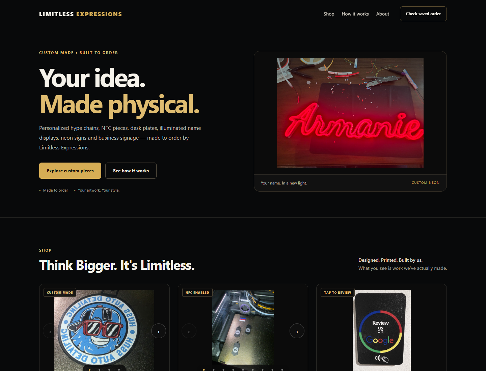
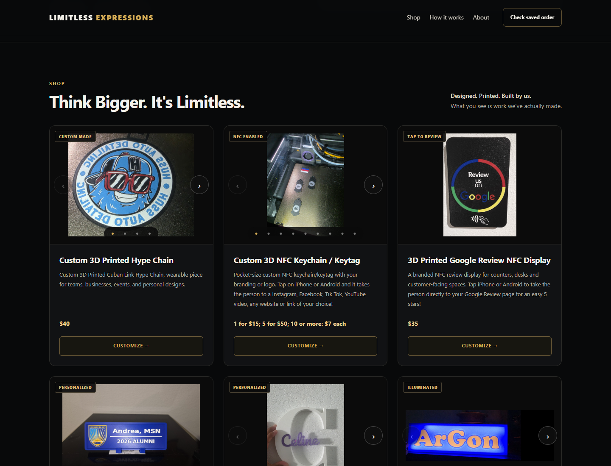
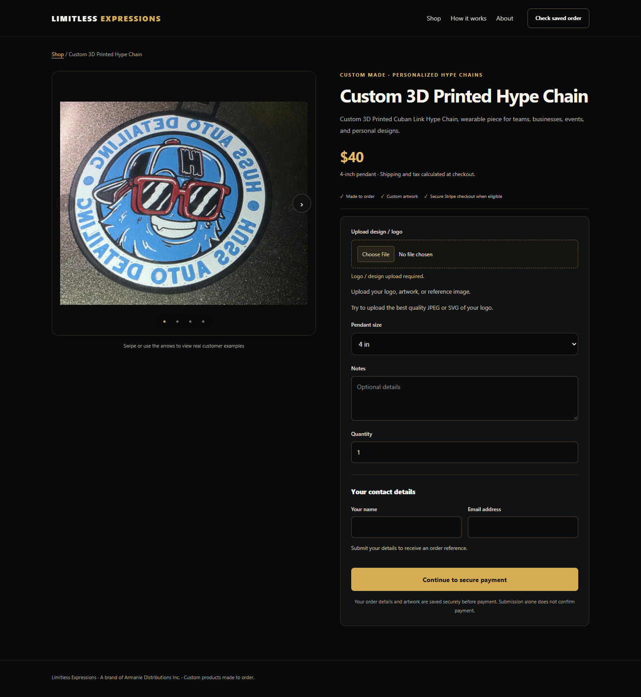
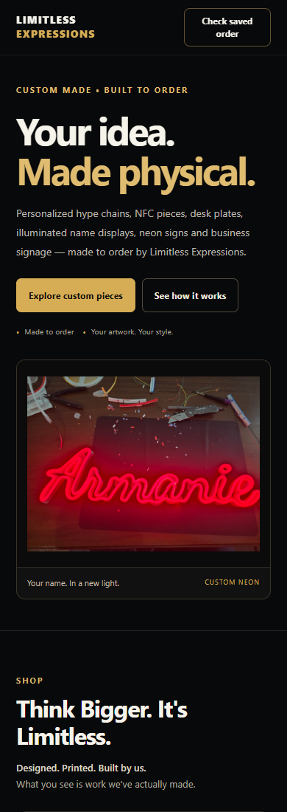

# Visual refinement review

Branch: `feature/premium-visual-refinement`, based on `origin/main` at `25a63b9`.

## Design

The black-and-gold branding is retained with a quieter charcoal palette, restrained borders, clear type sizes, more whitespace and consistent spacing. The homepage now has a split hero featuring existing neon photography and a direct catalog CTA. Cards have uniform image frames, aligned pricing/actions, readable descriptions and consistent row heights. Existing portrait/landscape photos fit entirely inside their frames rather than losing important details to a cover crop.

Product pages share balanced gallery/detail columns on desktop and a stacked layout on tablet/mobile. Forms have clearer grouping, consistent input/selection styling, visible focus states, larger buttons and separated customer/contact/payment information. Phone inputs use 16px text, and the layout works down to 320px. All neon styles, font cards, hollow previews, mounting options and live preview behavior remain intact.

The outdated homepage statement that delivery would only be connected when checkout goes live now says delivery details are confirmed before payment. No product, pricing or checkout promise was added.

## Scope

Production changes are a new `assets/visual-refinement.css` stylesheet and the small hero/stylesheet/copy edits in `index.html`. There are no new dependencies, new fonts, image replacements, backend changes or JavaScript behavior changes. All original photos, product data, pricing, Coming Soon functionality, form IDs/options, navigation and checkout are preserved.

Public photo styling uses contain/full-image framing and neutral transforms. The existing saved framing data and local photo-position editor remain untouched; the public contain overrides exclude editor mode. Borders, layout and typography are presentation only.

## Validation

- 20 existing preservation, order and Stripe checkout tests pass. The preservation test permits only the requested hero and delivery-copy presentation changes; other protected homepage markup, product data, neon assets, pricing and checkout snapshots remain checked.
- `node tests/product-pages.browser.cjs`: all eight products and homepage links at desktop/mobile sizes pass, including Back/Forward, galleries, uploads, Turnstile, saved selections, eligible Stripe redirects and quote-only submissions.
- `node tests/neon.browser.cjs`: all 48 font/text/viewport combinations and existing single-stroke, mounting, saved-selection and NFC checks pass.
- `node tests/visual-refinement.browser.cjs`: homepage plus eight product pages at 320, 390, 768 and 1440px (36 layout cases), including overflow, portrait-photo clipping, full-image containment, broken images, uniform image frames and accessible control sizing. Screenshots were visually inspected.

All browser services are mocked; tests create no live orders/payments. The site is static and has no build step. Set `VISUAL_SCREENSHOT_DIR` when running the visual browser test to regenerate screenshots for every page/size. No merge, deployment or pull request is created automatically.

## Review screenshots

[Desktop homepage](visual-review/homepage-desktop.png) · [Desktop catalog](visual-review/catalog-desktop.png) · [Mobile homepage](visual-review/homepage-mobile.png) · [Desktop Hype Chain](visual-review/hype-chain-desktop.png) · [Desktop Neon](visual-review/neon-desktop.png) · [Mobile Neon](visual-review/neon-mobile.png)

### Homepage

### Product page

### Mobile

